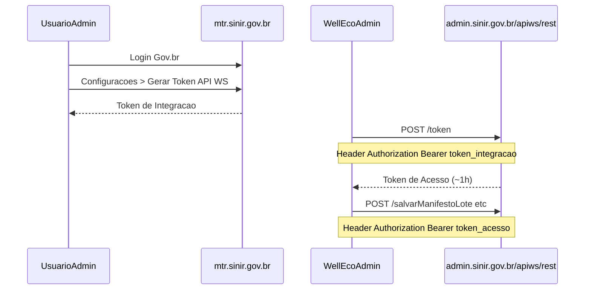

# Integração SINIR — MTR Nacional

> Atualizado em 2026-09-11 após teste real de autenticação.

## URLs oficiais

| Recurso | URL |
|---------|-----|
| Portal MTR (produção) | https://mtr.sinir.gov.br |
| API REST (produção) | `https://admin.sinir.gov.br/apiws/rest` |
| Portal documentação | https://portal-api.sinir.gov.br |
| Suporte MTR | mtr@sinir.gov.br |

**Homologação:** `homolog-admin.sinir.gov.br` e `homolog-mtr.sinir.gov.br` **não resolvem DNS** (indisponíveis em set/2026). Desenvolvimento deve usar produção com cuidado ou solicitar ambiente de teste ao MMA.

---

## Autenticação API — mudança crítica (01/08/2026)

O endpoint legado **`POST /gettoken`** com `cpfCnpj` + `senha` + `unidade` foi **desativado**.

Resposta atual (404):
```json
{
  "mensagem": "Endpoint desativado em 01/08/2026. A autenticação por usuário e senha foi removida desta API. Gere o Token de Integração no Sistema MTR (Configurações > Gerar Token API WS) e troque-o por um Token de Acesso em POST /apiws/rest/token.",
  "erro": true
}
```

### Novo fluxo (Web Service)



1. Acessar **https://mtr.sinir.gov.br** com **Gov.br** (obrigatório desde 01/08/2026 para interface web).
2. Menu **Configurações → Gerar Token API WS** (usuário administrador).
3. Copiar o **Token de Integração** gerado.
4. Trocar por token de acesso:
   ```http
   POST https://admin.sinir.gov.br/apiws/rest/token
   Authorization: Bearer {TOKEN_DE_INTEGRACAO}
   Content-Type: application/json
   ```
5. Usar o token de acesso retornado nas demais rotas (`salvarManifestoLote`, etc.).

Resposta atual de `POST /token` (set/2026):

```json
{
  "mensagem": "Autenticado com sucesso",
  "objetoResposta": "Bearer {token_acesso}",
  "erro": false
}
```

O `SinirAuthService` extrai o token de `objetoResposta` (com ou sem prefixo `Bearer`).

Erro se faltar token de integração:
```json
{"mensagem":"Token de integração não informado no header Authorization (Bearer).","erro":true}
```

---

## Credenciais Well Eco (cadastro existente)

| Campo | Valor |
|-------|-------|
| CNPJ | 18.675.233/0001-50 |
| Código público da unidade Well | **135551** (`parCodigo`, usado como transportador/destinador no manifesto) |
| Contexto interno do JWT | segundo ID do claim `sub` (ex.: 728407); **não é** o código público 135551 e não deve ser comparado com ele |
| Empresa | WIDMER TRINDADE DE BEM - ME |
| CPF usuário | 027.506.321-61 |

**Login/senha do portal:** válidos apenas para acesso **web** (via Gov.br). **Não servem mais** para `/gettoken` na API.

**Nunca commitar** senha ou token no Git. Preferência: `operadoras` / cadastros; `.env` como fallback piloto:

```env
SINIR_ENABLED=true
SINIR_ENV=production
SINIR_SSL_VERIFY=true
# Fallback piloto (também em operadoras.sinir_* via seed_operadora_well.php):
SINIR_UNIDADE=728559
SINIR_CNPJ=18675233000150
SINIR_INTEGRATION_TOKEN=
SINIR_UNIDADE_DESTINADOR=
```

Sincronizar operadora #1 a partir do `.env`: `php database/scripts/seed_operadora_well.php`

---

## Endpoints principais (pós-autenticação)

Base: `https://admin.sinir.gov.br/apiws/rest`

| Ação | Método | Rota |
|------|--------|------|
| Obter token acesso | POST | `/token` |
| Listar resíduos | GET | `/retornaListaResiduo` |
| Listar classes | GET | `/retornaListaClasse` |
| Listar unidades | GET | `/retornaListaUnidade` |
| Listar tratamentos | GET | `/retornaListaTratamento` |
| Listar estados físicos | GET | `/retornaListaEstadoFisico` |
| Listar acondicionamentos | GET | `/retornaListaAcondicionamento` |
| Emitir MTR | POST | `/salvarManifestoLote` — body = **array JSON** no schema **MMA/SIGOR** (`transportador`/`destinador`/`listaManifestoResiduos`). Wrapper `{manifestoJSONDtos:[…]}` → Tomcat 400. **Token deve ser de Gerador** (unidade JWT = `clientes.sinir_cod_unidade`). Data de expedição ≥ hoje. |
| Consultar MTR | GET | `/retornaManifesto/{manNumero}` — número nacional (12 dígitos); token **gerador** (fallback destinador/operadora). Persiste `sinir_codigo_barras` quando a API devolve. |
| Consultar (legado) | POST | `/retornaManifestoPorNumero/{num}` — ~10 dígitos (estadual) |
| PDF MTR | POST | `/downloadManifesto/{manNumero}` — `Accept: application/pdf, application/octet-stream, */*`; fallback `/buscaPdfManifestoPorCodigoBarras/{cod}` |
| Cancelar | POST | `/cancelarManifesto` — token **gerador** |
| Receber (destinador) | POST | `/receberManifestoLote` — body = **array raiz** MMA. Sem substituição, cada item leva apenas `resCodigoIbama`, `marQuantidade`, `marQuantidadeRecebida`, `traCodigo`. Wrapper `manifestoRecebimentoJSONs` → Tomcat 400. Token **destinador**. |
| Emitir CDF | POST | `/emiteCDF` — **Emitir CDF SINIR** (`SinirCdfService`) após recebimento |
| PDF CDF | POST | `/buscaPdfCdf/{codigo}` — cache em `storage/coletas/{id}/` |

Header em todas (exceto troca inicial): `Authorization: Bearer {token_acesso}`

Antes de receber, o service consulta o manifesto com o token do gerador e usa
resíduo, tratamento, unidade e quantidade **canônicos do SINIR**. A API pode
normalizar `1 kg` para `0,001 TON`; repetir a quantidade local causaria rejeição.
O nome do responsável vem de `destinadores.responsavel` (com snapshot da coleta
como fallback); recebimento e CDF não solicitam digitação manual no modal.
Esse nome deve existir na lista **Responsável pelo Recebimento** da unidade
destinadora no portal SINIR; nome abreviado ou apenas cadastrado no Well retorna
`Responsável pelo recebimento não encontrado`.
O segundo identificador do claim `sub` do JWT é interno ao contexto de
autenticação e pode ser diferente do `parCodigo` público do destinador. A
seleção da unidade correta deve ser feita no portal ao gerar o Token API WS;
não validar essa seleção comparando numericamente os dois identificadores.

---

## Manual correto vs MTR-LR

| Documento | Uso |
|-----------|-----|
| **MTR Regular — Manual v1.10** | Coleta Well (gerador/transportador/destinador) |
| **Manual Integração Web Service MMA** | Desenvolvimento API (verificar versão pós-ago/2026) |
| MTR-LR Manual do Usuário | Logística Reversa / Recicla+ — **não** é o fluxo Well |

PDF Regular: https://portal-api.sinir.gov.br/wp-content/uploads/2026/07/MANIFESTO-DE-TRANSPORTE-DE-RESIDUOS-%E2%80%93-MTR-1.10.pdf

---

## Implementação Well Eco (Fase B)

| Peça | Arquivo |
|------|---------|
| Auth token | `app/Service/Sinir/SinirAuthService.php` |
| HTTP API | `app/Service/Sinir/SinirGateway.php` |
| Payload MTR | `app/Service/Sinir/SinirPayloadBuilder.php` |
| Envio + auditoria | `app/Service/Sinir/SinirManifestoService.php` |
| Hook finalizar | `ColetaService::finalizar()` → `salvarManifestoLote` |
| Reenvio manual | Coletas → detalhe → **Registrar / reenviar SINIR** |
| Cancelamento | Coletas → detalhe → **Cancelar no SINIR** (`POST /cancelarManifesto`) |
| Consulta situação | Coletas → detalhe → **Consultar SINIR** (`GET /retornaManifesto/{nacional}` ou `POST retornaManifestoPorNumero/{legado}`) |

### Pré-requisitos antes do envio

### Tokens: o que fica onde (multitenancy)

| Token | Onde | Uso |
|-------|------|-----|
| Operadora (Well piloto) | `operadoras.sinir_*` → fallback `.env` | Listas, sync; fallback receber/CDF |
| Gerador (cliente) | `clientes.sinir_integration_token` | **Emitir MTR** |
| Destinador | `destinadores.sinir_integration_token` | **Receber MTR / CDF** (obrigatório se destinador ≠ operadora) |
| Transportadora | `transportadoras.sinir_cod_unidade` | Unidade no JSON da emissão (sem token) |

`.env` idealmente só: `SINIR_ENABLED`, `SINIR_ENV`, `SINIR_SSL_VERIFY` (+ fallback piloto).

1. Migrations `052` (cliente) e `053` (destinador) aplicadas
2. **Cliente:** unidade + token gerador (admin ou portal `/gerador/perfil`)
3. **Destinador:** unidade + token (terceiro); Well padrão pode herdar operadora/`.env`
4. **Transportadora:** unidade SINIR no banco
5. **Tipo de resíduo:** mapeamento `tra/tie/tia/cla/uni_codigo`

### Smoke test (CLI)

```bash
php database/scripts/sinir_diagnose_rede.php   # 1º — testa se o servidor alcança a API
php database/scripts/sinir_smoke_token.php       # 2º — testa token de integração
php database/scripts/sinir_sync_residuos.php --dry-run --csv=storage/sinir_sync.csv
php database/scripts/sinir_sync_residuos.php     # aplica códigos sugeridos
```

### Sync códigos em tipos_residuos

Script `sinir_sync_residuos.php` consulta as listas oficiais e preenche `cod_ibama` + `tra/tie/tia/cla/uni_codigo` em `tipos_residuos`.

| Flag | Efeito |
|------|--------|
| `--dry-run` | Simula sem gravar no banco |
| `--force` | Sobrescreve tipos que já têm códigos |
| `--all` | Inclui tipos já completos (default: só vazios) |
| `--csv=caminho` | Exporta sugestões para revisão |
| `--dump-lists=caminho` | Salva JSON bruto das listas SINIR |

**Defaults operacionais Well** (quando a API não amarra resíduo → tecnologia/estado/etc.):

- Unidade: Quilograma (kg)
- Estado: Sólido (líquido se nome contém óleo/água)
- Acondicionamento: inferido do nome (big bag, tambor, granel…)
- Classe: Classe II A para recicláveis; Classe I para perigosos / `(*)`
- Tecnologia: Reciclagem (RSS/saúde → incineração quando existir na lista)

Revisar o CSV antes de aplicar em produção. Em XAMPP local, se curl falhar com certificado SSL: `SINIR_SSL_VERIFY=false` no `.env`.

### HTTP 400 em “Gerar MTR”

O pré-check do painel só valida unidades/token/itens. Um **400** vem da API após o envio.

1. No modal de erro, a mensagem deve trazer o texto do SINIR (não só “HTTP 400”).
2. Se a resposta for **HTML Tomcat** (`Content-Type: text/html`, “HTTP Status 400 – Bad Request”), é rejeição no conector (não JSON de negócio). Causas já vistas: **`Content-Length` duplicado** e header **`Expect:` vazio** (Tomcat 9). O gateway atual: sem `Content-Length` manual, **sem** `Expect`, `Content-Type: application/json`, HTTP/1.1.
3. Na VPS, reproduza com dump completo:
   ```bash
   php database/scripts/sinir_debug_salvar_manifesto.php {coleta_id}
   php database/scripts/dump_last_sinir_envio.php {coleta_id}
   ```
4. Causas frequentes: código IBAMA inválido ou sem `(*)` em perigoso; **`greCodigo` ausente** em resíduo perigoso/RSS; CNPJ/unidade do gerador não batem no portal; quantidade &lt; 0,1 kg; token da transportadora sem permissão sobre a unidade geradora.

O campo `residuo` no JSON vai como **6 dígitos** (ex.: `150203`) e **com `(*)`** quando o cadastro indica perigoso (ex.: `200121(*)`).

**Número do manifesto nacional** (ex. 12 dígitos) persiste em `coletas.sinir_man_numero`; `numero_mtr` (int) só recebe códigos que cabem em `int unsigned` (legado/estadual curto). Exibição e PDF usam `ColetaMtrHelper::numeroExibicao()` (prioriza `sinir_man_numero`).

**Grupo de embalagem (`greCodigo`)** — obrigatório na API nacional quando o IBAMA tem `(*)`, é RSS (grupos A–E / A1–A5) ou código especial `200132`. Valores: **1=I, 2=II, 3=III, 4=N/A**. Com perigoso, o SINIR também exige **`marNumeroONU`**, **`marClasseRisco`** e **`marNomeEmbarque`**. Padrão Well quando `greCodigo=4`: os três campos vão como **`NAO SE APLICA`**. Se usar gre 1–3, cadastre ONU/risco/embarque no tipo de resíduo (campos previstos na entidade; UI admin em evolução).

### Timeout / `http_status: 0`

Se o smoke test retorna `Operation timed out` com `http_status: 0`, **não é erro do token** — o PHP no servidor **não consegue conectar** a `admin.sinir.gov.br`.

No SSH da HostGator:

```bash
curl -v --connect-timeout 15 -X POST https://admin.sinir.gov.br/apiws/rest/token \
  -H "Content-Type: application/json" \
  -H "Authorization: Bearer SEU_TOKEN"
```

| Resultado curl | Ação |
|----------------|------|
| Timeout / Connection refused | Abrir ticket **HostGator**: liberar outbound HTTPS para `admin.sinir.gov.br:443` |
| Conecta mas 401/403 | Token inválido ou expirado — gerar novo no portal MTR |
| Conecta e retorna JSON | Rede OK — rodar `sinir_smoke_token.php` de novo |

Em hospedagem compartilhada, o SINIR pode bloquear IPs de datacenter. Se a HostGator liberar e ainda falhar, contatar **mtr@sinir.gov.br** informando o IP público do servidor (cPanel → Informações gerais).

### Fluxo ao finalizar coleta

1. Coleta recebe MTR local e status `finalizada`
2. Se `SINIR_ENABLED=true`, status SINIR → `pendente` e dispara envio
3. Sucesso → `sinir_status=enviado`, `sinir_man_numero`, `sinir_codigo_barras`
4. Falha → `sinir_status=erro`, histórico em `sinir_envios` (reenvio pelo painel)

> Falha no SINIR **não cancela** a finalização local da coleta.
